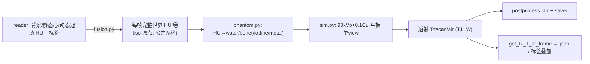

# XCIST 投影后端设计（`XcistDRR` / `XcistBackend`）

> 状态：**已接入主流程**（2026-10-15）。spike 的 `xcist/{geometry,phantom,sim}.py`
> 已与 `RotateDSA` 打通：`rotate_drr/xcist_drr.py`（mono/poly）+ 可选剂量估计，
> 回归测试 `test/test_xcist.py`（一致性 / 旋转可视化 / 剂量 / 真实协议）。

## 目标
在 `RotateDSA/DiffDRR` 之外提供一条**物理保真（多能谱 + 平板 + 可选噪声）**
的旋转 DSA 生成路径，输出与现有管线同构的文件集
（`rotate_dsa_raw.tif / rotate_dsa.gif / rotate_dsa.json / label / depth_map`），
用于离线数据增强与对比实验。

## 两种接入形态（决定架构）

| 形态 | 实现 | 与 `RotateDSA` 的关系 |
|---|---|---|
| `mode="mono"` 单能 | `physics.monochromatic=E` → `T=exp(-∫μds)` | **真 drop-in**：返回 `-lnT`，多层线积分可加、静态层批量优化全部保留 |
| `mode="poly"` 多能 | 真实能谱(90kVp+0.1Cu)+平板 | **非 drop-in**：走"延迟融合"，见下节 |
| `XcistBackend` | 独立编排器（静态案例/演示） | 不动 `RotateDSA`，复用 `postprocess_drr`/`saver` |

## 多阶段分层投影怎么处理（关键）

`RotateDSA.run()` 本身是"两阶段 + 末尾统一 Beer-Lambert"：

1. **Stage 1 静态层批量**：`reader.get_static_data()` 返回 N 层（背景胸腔 / 静态心腔 / …，
   各层已互相"挖空"避免重复计数）→ 每层调一次
   `get_projections_at_frames(range(T))` → `frames += layer`（**log 域相加**）。
2. **Stage 2 动态层逐帧**：每帧 `get_projection_at_frame(f, 冠脉动卷, 标签)`；
   伪影由 Torch3D 线积分在 log 域近似叠加 → `frames[f] += drr_res`。
3. **末尾** `frames = exp(-frames)`（统一 Beer-Lambert）→ `postprocess_drr`。

XCIST 后端按"层间能否相加"分两种适配：

- **mono（可加 ✅）**：单能下 `T=exp(-∫μds)` 严格成立，`-lnT = ∫μds` 对**层线性可加**，
  所以上面的两阶段编排**原样适用**。`XcistDRR` 只把每层 μ 转成单材料水当量密度
  `ρ=μ/μ_w(E)`（单能下精确复现原 μ）后逐层投影。→ 与 `TorchDRR` 数值同构
  （斜视角 NCC ≈ 0.9999），可当对照/学习数据。
- **poly（不可加 ⚠️）**：能谱+探测非线性使"层相加"不成立（束硬化取决于总路径长）
  → **延迟融合**：
  * Stage 1：`get_projections_at_frames` 只**缓存**静态层体积、返回全 0（不参与相加）；
  * Stage 2：把缓存静态层 + 本帧动态层**融合成单一材料体**（{water,bone,iodine}，
    碘由 `coronary` 标签给出），整卷一次投影，返回 `E_eff = -ln T_eff`；
  * 编排器末尾的 `exp(-frames)` 恰好还原 `T_eff` ✓（对 `RotateDSA` 完全透明）。
  * 伪影仍是 log 域近似叠加；要严格一致需把伪影 mesh 体素化为金属材料（未做）。

> 另：`XcistBackend` 是更简单的另一条路径——自己把每帧融合成完整世界卷再投影，
> 不经过 `RotateDSA`，用于静态案例与剂量演示。

## 剂量（可选，默认关闭）
`XcistDRR(dose_cfg=DoseConfig(...))` 启用后，`RotateDSA.run_and_save` 会同步输出
`dose.npy` / `dose.mGy` 并把统计写进 `rotate_dsa.json["dose"]`。
剂量用**独立非单能仿真器**（不受 mono 影响），沉积介质优先
`set_dose_reference_hu(...)` 提供的参考 CT，缺省回退到 DRR 的 μ 体积反推 HU；
按协议均匀子采样 K 个视角逐 view 沉积后 ×(总帧/K)。

### 剂量指标口径（三套并列，别混用）

| 口径 | 定义 | 用途 | 可比较性 |
|---|---|---|---|
| `stats.whole_*` | 整个剂量网格的吸收剂量统计（air 也算） | 快速体检、FOV 整体 | 网格/FOV 一变就不可比 |
| `stats.iso` | `dose[n//2,n//2,ns//2]`，旋转轴上**单个体素** | 等中心剂量点估值 | 只对本协议可比 |
| `stats.roi_mean / roi_p99_9` | 传入 `roi_mask`（如心腔/冠脉）内的统计 | 关心器官的剂量 | 器官级，同解剖可比 |
| `ctdi.mean100` | 均匀体模中心/周边在**中央 100mm 层厚**的平均剂量（宽束等价） | 平板 C 臂（束宽 > 100mm） | 需同体模/同几何 |
| `ctdi.ctdi100` | `mean100 × 100 / nT`，`nT` = 本几何在等中心的束宽 | 严格 CTDI100 定义 | 仅 `nT ≤ 100mm` 时可与临床比 |
| `ctdi.ctdi_w` | `1/3·center + 2/3·periph`（对 ctdi100） | 加权剂量指数 | 同上（本平板几何 nT≈185mm → 偏小） |
| `ctdi.ctdi_w_mean100` | 同上加权，但用 `mean100` | **平板 C 臂应引用这个** | 最接近临床 CTDI_w 的量级 |
| `ctdi.per_100mAs` | 上述 /(mAs/360°) ×100 | 跨协议/机型对照 | 同机型可比 |

CTDI 口径由 `dose.estimate_ctdi_like()` 实现，`XcistDRR.estimate_ctdi()` 负责把协议
接进去（每度视角数 = 总帧数/|扫角|，把扫角补成 360°；`mAs/rot = mA·exposure_s·n_views_360`）。
要点与坑：

- **体模默认 16 cm 水当量（PMMA, HU≈+120）**。若选 32 cm，周边测量点 r=150mm 会
  超出平板扇束半宽（本 pig 几何等中心 FOV≈253mm，尚可；128 面板仅 65mm 时必偏小），
  函数会在 `ctdi.warnings` 里报 `periph_fan_coverage` 不足。
- `mAs_per_rotation` 与 `stats.whole_mean` 的 mAs 口径不同：前者是 **360° 等效**，
  后者是**本协议扫角**（如 240°/60 帧）。别直接相除比较。
- 本引擎**无散射**，材料只有 water/bone，故只能与"同类平板 C 臂/CBCT"同口径比较，
  不能等同医用 CT 的 `CTDIvol`（后者另有 pitch/床移动/散射/电离室刻度）。
- `estimate_ctdi()` 可用 `CtdiConfig.detector_downsample=3` 粗化平板（面板尺寸与总通量
  不变），把 474×648 面板的 72 视角耗时从分钟级压到 ~10 s。

### pig_data_drr 报告测试
`test/test_xcist.py::test_xcist_pig_report` 用真实 C 臂几何（474×648 @0.616mm，
SID760/SDD1200）出全套产物到 `test/output/xcist/pig_report/`：
`frames/*.png + rotate_dsa.gif`（6 帧覆盖全扫角）、`dose.npy/.mGy`、
`dose_slices.png`（三向 MIP + 心腔 ROI 轮廓）、`ctdi_phantom.png`（体模中心层 + 径向剖面）、
`report.json`（图像 NCC + 患者/心脏 ROI 剂量 + CTDI 全部口径）。
剂量介质用真实 HU 的 NIfTI（**不要**用 reader 的 `volume_centering`：那是 μ 体积，
且含 DSA 用的夸张造影 μ=0.25/mm）。

### 与设备实测剂量对账（2026-10-15，`temp/xcist_measured_compare.py`）
设备协议：3s 3D DSA、200°、187 帧、60 fps、90 kV；16 cm 体模
（`temp/剂量统计.xlsx`，两个列：电离室实测 / 设备剂量报告）。

| 参数 | mAs | 我 Ka,r | 我 CTDI₁₆(200°实拍) | 电离室 | 我 CTDI₁₆@360° | 设备报告 |
|---|---|---|---|---|---|---|
| 50mA 0.1Cu 3.29ms | 30.76 | 1.313 | 2.030 | 1.796（+13%） | 3.654 | 3.915（**−7%**） |
| 60mA 0.1Cu 3.30ms | 37.03 | 1.581 | 2.444 | 2.040（+20%） | 4.399 | 4.449（**−1%**） |

结论（重要）：
1. **设备「剂量报告」= 归一到一个 360° 旋转的 CTDI 指数**，不是本次 200° 的实拍累积。
   证据：同一曝光下 `胸模` 与 `CTDI_16cm` 两行的报告值完全相同（3.915 / 3.917）
   → 报告值与体模无关，是按曝光参数算的指数；且换到 360° 归一后与我的 CTDI 吻合到 1–7%。
2. **电离室列 = 实拍 200° 累积**；我比它高 13–20%（本引擎无散射 + 均匀 PMMA 近似）。
3. `报告 / 电离室 = 2.18 ≈ (360/200) × 1.21` —— 2.18 在 50/60 mA 两行**完全一致**，
   说明是纯口径因子，不是物理偏差。
4. **Cu 过滤的衰减偏弱**：我的 0Cu/0.1Cu = 1.52（Ka,r）/1.35（CTDI），设备为 1.86；
   即我的能谱被 Cu 削得不够（滤过低能成分偏少）。绝对基准点（0.1Cu）已对齐，
   但做"无滤过 vs 有滤过"对照会偏保守。
5. **mA 非线性**：设备 50→140 mA 报告只涨 2.25×（名义 2.8×）→ 3.3 ms 脉冲下
   实际 mAs 达不到设定值（管电流上升时间）。用设定 mA 线性外推会**高估 15–20%**，
   要精确对账请用发电机实际 mAs。

### 体素质量归一化（已修 bug）
官方 `img2vol` 用 **各向同性** 体素 `(fov/n)³` 算质量（隐含 `sliceThickness == fov/n`），
但能量沉积用的是 `(voxel_xy, voxel_z)` → 当 `vz ≠ vxy` 时**剂量正比于层厚**
（实测 2/4/5/8 mm → 1:2:2.5:4）。现改为真实体素体积 `vxy²·vz`，剂量与层厚无关
（`hu_to_dose_basis`）；`test_xcist_ctdi_slice_thickness_invariance` 守住此性质。

## 模块职责
| 模块 | 职责 | 状态 |
|---|---|---|
| `geometry.py` | CArm/RotatedParameters → xcist scanner/protocol；alpha→beta；翻转(-1,-1)；`project_point` oracle | ✅ 验证 |
| `phantom.py` | 世界体积 → 规范网格 (Nz,Ny,Nx) 材料密度体 + .vp 写盘（含 Y 镜像约定）+ 材料分解 | ✅ |
| `sim.py` | CatSim 复用实例，单/多 view、air 归一化透射、`centerOffset` 摆位、噪声开关/曝光参数 | ✅ |
| `rotate_drr/xcist_drr.py` | **主流程接入**：mono drop-in / poly 延迟融合；R/T 与 TorchDRR 同帧对齐；可选剂量 | ✅ |
| `dose.py` | 剂量重建封装（显式 viewangles、HU→μ/密度/质量、体素 Y 约定修正）+ **CTDI-like 口径**（`CtdiConfig`/`estimate_ctdi_like`） | ✅ |
| `backend.py` | 独立编排：逐帧融合→投影→postprocess→saver→json（静态案例） | 🔶 演示可用 |
| `test/test_xcist.py` | 回归：几何一致性(NCC)、旋转可视化产物、剂量、真实协议、pig_data_drr 报告 | ✅ 7 项 |

## 数据流

## 输出
- `rotate_dsa_raw.tif`：float32 透射（T,H,W 逐帧）
- `rotate_dsa.gif / rotate_dsa/<NNN>.png`：`postprocess_drr(uint8)`（gamma+百分位）
- `rotate_dsa.json`：c_arm 几何、spectrum/过滤/曝光物理、逐帧 alpha/beta/phase/time；
  `additional_config`（renderer/mode/…/dose 配置）；启用剂量时多一个 `dose` 段
- 启用剂量时：`dose.npy` + `dose.mGy`（raw float32，gecatsim 官方格式）
- `label.gif / depth_map.npz`：复用 Torch3DLabelRenderer + 同一 R/T

## 阶段
- [x] S1 spike：几何/朝向/旋转标定（修正 3 个约定 bug 后 vs DiffDRR 全角度 NCC 0.9998~0.9999）
- [x] S2 `XcistDRR` 接入 `RotateDSA`：mono drop-in、poly 延迟融合、批量与逐帧一致(max|Δ|≈3e-7)
- [x] S3 剂量：`dose.py` + `XcistDRR.estimate_run_dose`，随 `run_and_save` 同步输出 + json 元数据
- [x] S4 回归测试 `test/test_xcist.py`（含真实协议 90kV/50mA/0.1Cu/3.3ms、60fps/75°/s/3s）
- [x] S4b 剂量指标口径：`stats`(whole/iso/roi) 与 `ctdi`(mean100/ctdi100/ctdi_w/per_100mAs) 并列
- [x] S4c pig_data_drr 报告（图像 + 患者/ROI 剂量 + CTDI 图与 json）
- [ ] S5 脚本化 `scripts/*_generate_dsa.py` 的后端/剂量开关 + readme；伪影金属体素化；poly 端到端耗时评估
