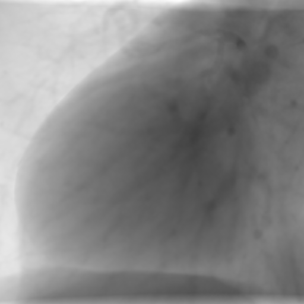
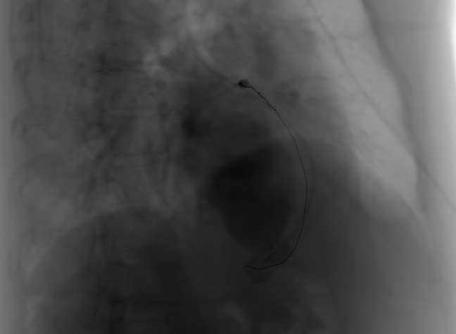
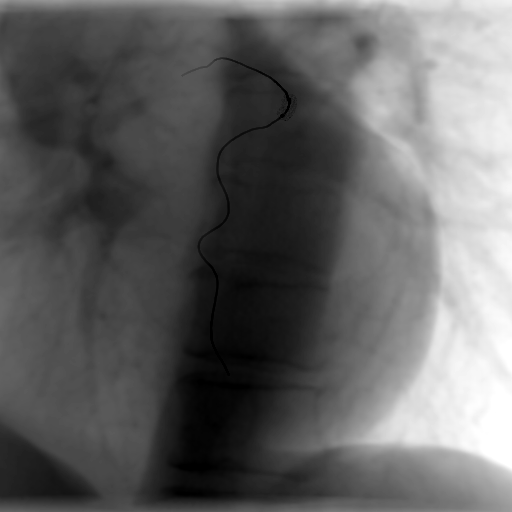
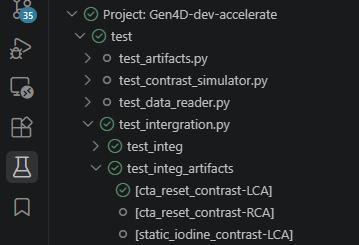
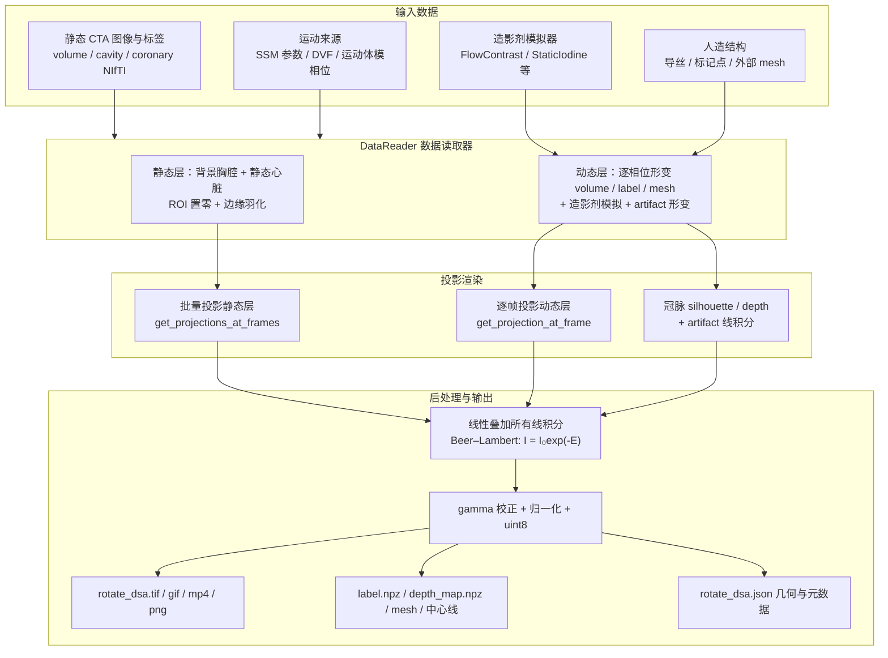
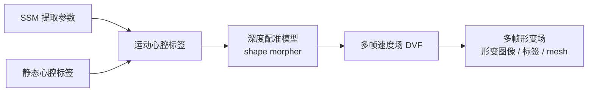
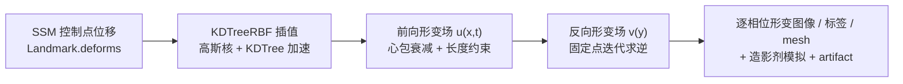
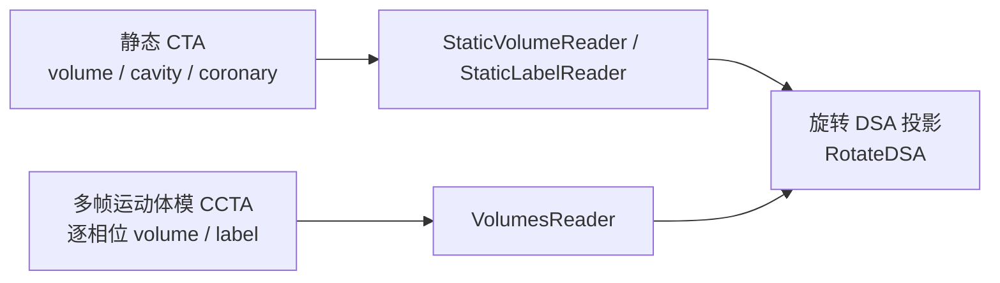

# Generate 4D Heart

这是一个生成**旋转冠脉造影**（Rotate X-ray Coronary Angiography, RXCA）或 **数字剪影** DSA 模拟数据的项目（由于开发前期没有明确区分这两者，导致存在一定的名称混用现象）


> 对应 `pytest test/test_intergration.py::test_integ_full[rbf_reader-flow_contrast-LCA]`


> 对应 `pixi run python scripts/rbf_generate_dsa_chest_full.py --simulator-name flow-contrast`


> 对应 `pytest test/test_intergration.py::test_integ[static_label_reader-flow_contrast-RCA]`


> 对应 `pytest test/test_intergration.py::test_integ_artifacts[cta_reset_contrast-LCA]`

## 环境配置

此项目依赖 [pixi](https://pixi.sh/) 配置python环境。系统环境为(仅供参考)

```txt
OS: Ubuntu 22.04.3 LTS (Jammy Jellyfish) x86_64
Kernel: Linux 6.8.0-136-generic
GPU: NVIDIA GeForce RTX 3090
cuda-runtime:
    NVIDIA-SMI 580.173.02, Driver
    Version: 580.173.02
    CUDA Version: 13.0
cuda-toolkit(nvcc): release 12.0, V12.0.76
```

通过 `git clone` 下载项目，然后进入到项目目录中，使用 `pixi install --frozen` 从 `pixi.lock` 安装环境。该方法确保环境的一致性，避免因依赖版本变化引起的问题。

如果安装失败，可能是由于某些依赖包在当前环境中无法安装。可以尝试以下步骤：

+ 使用 `pixi install` 重新安装，这将允许pixi根据当前环境自动调整依赖版本。
+ 如果仍然无法安装，检查错误日志，确定是哪个包导致安装失败，并修改 `pixi.toml` 中对应包的版本

安装完成后，可以使用 `pixi shell` 进入环境，或者使用 `pixi run <command>` 直接运行命令，例如 `pixi run python scripts/rbf_generate_dsa_chest_full.py`。

## 运行

目前项目仍在开发中，尚未实现完整稳定的接口，推荐查看 `tests/` 和 `scripts/` 目录下的测试用例和脚本了解项目的使用方法和功能，并实现自己的数据处理脚本。

### test/ 测试用例

使用`pytest`运行`test/`目录下的测试用例得到可视化结果（需要注意一些测试项耗时较长）。测试所用数据`test/test_data` 可以在 [google drive](https://drive.google.com/drive/folders/1vPh2uCSvOnzwjB3b1B62WKwqlZF-wvde?usp=sharing) 下载，测试输出结果在 `test/output/` 下。

test_data/ 文件结构为

```text
- cavity.nii.gz         # 心腔分割标签，通过 mmWHS 数据集训练的 nnUNet 分割 ASOCA 图像得到
- coronary.nii.gz       # 冠脉分割标签，来源于 ASOCA 数据集
- image.nii.gz          # CTA 数据，来源于 ASOCA 数据集

- chest_data/               # 含有完整胸腔的数据，来源于私有数据集
    |- background.nii.gz    # 完整胸腔CTA
    |- image.nii.gz         # 指向 ./cta_single/ 下文件的symlink（导出时自动进行了解析，所以下载到的数据会是一个单独的nii文件）
    |- coronary.nii.gz      # 同上
    |- cavity.nii.gz        # 同上
    |- cta_from_chest/      
        |- image.nii.gz     # 从 ../background.nii.gz (完整胸腔CTA) 中截取ROI得到的心脏CTA数据，分辨率较低，但不会有错位
        |- cavity.nii.gz    # 从 ./image.nii.gz 中分割得到的心腔（nnUNet 分割+手动修正）
        |- coronary.nii.gz  # 从 ./image.nii.gz 中分割得到的冠脉（私有数据训练的 nnUNet）
    |- cta_single/
        |- image.nii.gz     # 独立于 background 的单独CTA文件，分辨率较高，但和 background 无法完全对齐
        |- cavity.nii.gz
        |- coronary.nii.gz

- volume_with_dvf/          # 用于测试 CNN 生成密集速度场并生成形变（旧实现）
    |- image, cavity, coronary  # 与 ../image.nii.gz 等相同，为 ASOCA 数据
    |- Normal_01.json       # 用于VolumeDVFReader的形变场ROI数据，可以由scripts/predict_dvf.py生成
    |- dvf/
        |- phase_00.nii.gz  # 密集速度场，可以由scripts/predict_dvf.py生成
        |- phase_01.nii.gz  ...

- volumes/  # 由 [XCAT](https://cvit.duke.edu/resource/xcat-phantom-program/) 生成的数字体模数据
    |- image/, cavity/ coronary/    # 逐相位数据

- rbf_reader_flow_contrast_LCA/     # 生成的合成数据，文件结构参考下方 RotateDSA 输出说明 一节。用于对一些格式转换脚本进行测试
```

测试中展示了期望的模块接口和调用方式（例如 初始化数据读取器 `RBFReader(volume_nii=..., cavity_nii=..., ...)`; 获取动态数据 `reader.get_data(phase, coronary_type)`、投影系统初始化等 `RotateDSA(reader=..., drr=...)`等），可以作为脚本改写和新功能接入时的参考。

推荐使用 推荐使用 vscode 搭配 test 窗格使用，可以直观地选择需要执行的测试项，生成需要的可视化数据



### scripts/ 批量处理脚本

`scripts/` 下是一些 **批量生成数据** 和 **生成结果格式处理** 的脚本。**需要注意的是**，其中批量处理脚本中可能硬编码了路径和参数，使用时需要调整；且DVF相关脚本近期未经过重复测试。

`scripts/` 目录中的脚本文件与解释如下：

#### 格式转换

+ `convert_json_to_proj_matrics.py`: 将生成的 投影数据json(一般命名为 rotate DSA，包含有投影几何和旋转角度信息) 转换为投影矩阵的形式。可以指定不同的相机坐标约定，如OpenGL, pytorch3D, NeRF, GS 等
+ `convert_pngs_to_colmap.py`：将生成的旋转 DSA png 图像和标签转化为 colmap 组织形式。输入为旋转DSA图像和标签文件夹，输出为colmap格式的文件夹。从而可以被一般的GS / NeRF 重建算法库读取（如nerfstudio）
+ `convert_tif_to_dicom.py`: 原始投影数据tif + 投影数据json → dicom 格式，其中心动相位信息保存到了 `00711010` tag

#### 旋转 DSA / 4D 数据生成

+ `predict_dvf.py`：深度配准（shape morpher）推理入口，从静态心腔标签预测多相位密集速度场（DVF）并保存 ROI 信息，是 DVF 流水线的前置步骤
+ `dvf_generate_4d.py`：将 `predict_dvf.py` 生成的速度场（DVF）与 ROI 信息应用到静态图像/冠脉标签上，形变得到多相位 4D CTA
+ `dvf_generate_dsa.py`：批量从 DVF 生成旋转 DSA（`VolumeDVFReader` + `MovementEnhancer`），输入图像/标签/速度场，输出旋转 DSA 图像与标签
+ `rbf_generate_4d.py`：使用 `RBFReader` 离线批量生成逐相位的 3D 数据（volume / cavity label / cor label / mesh），不做 DRR 投影
+ `rbf_generate_dsa.py`：批量生成旋转 DSA 的主入口（`RBFReader` 或 `StaticVolumeReader`），支持 DRR / 仅标签 / 仅 3D 数据等多种输出模式
+ `rbf_generate_dsa_chest_full.py`：完整胸腔（带 `background_nii` 背景）场景的 RBF 旋转 DSA 生成，集成 `artifact_manager` 人造结构，使用大范围多帧旋转协议

### pyotes/

里面存放了一些前期开发实验所使用的临时 jupyter notebook，因有

## 主要架构

### 整体框架

整个管线由 `generate_4d_heart/rotate_dsa/rotate_dsa.py` 中的 `RotateDSA` 类编排，核心思想是 **"多层静态层 + 逐帧动态层" 的线性积分叠加**：由于 X 射线投影（DRR）是线性积分，各层（背景胸腔、静态心脏、形变后的冠脉/心腔等）可分别投影后直接相加，最后一次性应用 Beer–Lambert 定律得到灰度图像。

主要组件：

+ **`DataReader`**（数据读取器，协议见 `data_reader/data_reader.py`）：读取静态 CTA 与标签，按心动相位生成动态 `volume / label / mesh`（含造影剂模拟与 artifact 形变）。三种心脏运动生成方式对应不同实现（见下节）。
+ **`RotateDRR`**（投影器，见 `rotate_drr/`）：由 `CArmGeometry`（SDD / SOD / 像素尺寸 / AP/PA 朝向）与 `RotatedParameters`（帧数、角速度、fps、ZXY 欧拉角旋转协议）描述 C 臂几何，对每个 frame 计算 DRR 线积分并返回相机位姿 `R/T`。当前实现为基于 [DiffDRR](https://github.com/eigenvivek/DiffDRR) 的 `TorchDRR`。
+ **`Torch3DLabelRenderer`**（标签渲染器，`torch3d_label_renderer.py`）：用 PyTorch3D 栅格化渲染冠脉 mesh 的 silhouette / depth，以及导丝、标记点等 artifact 的 X 射线线积分。
+ **`RotateDSA`**（编排器）：两阶段流水线（静态层批量投影 + 逐帧动态渲染），并负责后处理与全部输出文件的保存。



运行流程（`RotateDSA.run()`）：

1. **静态层批量投影**：对 `reader.get_static_data()` 返回的各静态层（背景胸腔、心脏ROI外区域等）在全部帧角度上批量渲染线积分；各层将下一层占据的区域置零（或边缘羽化），避免重复计数。
2. **逐帧动态渲染**：生产线程按帧读取 `reader.get_dynamic_data(phase, coronary_type, time)`（相位由 `CardiacPhase.from_time` 从帧时间换算），主线程逐帧投影形变后的冠脉/心腔 volume，并渲染标签与深度图；可选叠加 artifact 线积分。
3. **叠加与成像**：所有线积分线性累加后施加 Beer–Lambert 变换 `frames = exp(-frames)`，再经 `postprocess_drr`（gamma 校正 + 百分位归一化 + uint8）得到可视化帧。
4. **保存输出**：TIF/GIF/MP4/PNG 图像、标签、深度图、Phase 0 数据（NIfTI / mesh / 中心线）以及包含 C 臂几何、旋转参数与逐帧角度/相位/时间信息的 `rotate_dsa.json`。

### 心脏运动生成

三种心脏运动生成方式主要在 **`DataReader` 实现**上区分，其输出均统一为逐相位的动态 `volume / label / mesh`，从而共享同一套投影与后处理管线。

| 方式 | 运动来源 | 关键模块 | 状态 |
| --- | --- | --- | --- |
| 1. SSM + 深度配准（DVF） | 深度配准模型预测的多帧速度场 | `VolumeDVFReader`, `moving_dvf`, `MovementEnhancer` | 不推荐（运动不自然） |
| 2. SSM + RBF 插值（**推荐**） | SSM 控制点位移经 KDTree RBF 插值 | `RBFReader`, `KDTreeRBF` | ✅ 默认推荐 |
| 3. 静态数据 / 运动体模 CCTA | 逐相位体模体积（无形变） | `VolumesReader`, `StaticVolumeReader`, `StaticLabelReader` | 简单直接 |

#### SSM 提取（统计形状模型，前置步骤）

方式 1 与方式 2 均以 **SSM（Statistical Shape Model，统计形状模型）** 作为心脏运动来源：SSM 从 XCAT 体模的多相位心腔数据中**离线**提取，代码位于独立仓库：

+ [BloomingStone/XCATV2-Statistical-Shape-Model](https://github.com/BloomingStone/XCATV2-Statistical-Shape-Model)：从 XCATV2 模型生成心脏统计形状模型

大致方法：

1. 取 XCATV2 体模的多相位心腔表面（左室 / 右室 / 心房 / 心肌等，对应 `CavityLabel`），建立跨相位、跨样本的**表面点对应**；
2. 去除全局刚体运动（Procrustes 对齐）后，对各相位形变做主成分分析（PCA），得到形状主成分 $\mathbf{P}$ 与运动参数 $\mathbf{b}$；
3. 输出模板表面 `ssm_template.vtk` 与主成分数据 `b_motion.npy`、`P_motion.npy`，任意相位的心腔形变可由 $\mathbf{b} \cdot \mathbf{P}$ 线性组合近似合成。

本项目通过 `generate_4d_heart/ssm/` 的 `SSMReader` 加载上述产物（默认位于 `ssm/ssm_world/`）。`SSMReader.load(cavity, ...)` 先把模板表面配准到病人心腔表面（`deform_surface`，基于 PyTorch3D 的 Chamfer / Laplacian / edge 损失微调），再按尺度缩放与 `motion_multiplier` 生成逐相位控制点位移 `Landmark.deforms`，供方式 1（DVF）与方式 2（RBF）使用。

#### 方式 1：体模 SSM + 深度配准模型（DVF）

主要参考了TT-UNet 的流程：[ZihengD/TT-U-Net: TT U-Net: Temporal Transformer U-Net for motion artifact reduction in dynamic cardiac CT](https://github.com/ZihengD/TT-U-Net)

从 XCAT 体模数据提取 SSM（提前离线完成）得到运动心腔标签，用深度配准模型（shape morpher）将 SSM 运动迁移到病人心腔，得到多帧速度场（DVF），再据此形变静态图像与标签生成运动序列。



+ 生成形变场部分对应 `generate_4d_heart/moving_dvf`、`scripts/dvf_generate_4d.py` 与 `scripts/predict_dvf.py`：输入 SSM 参数与心腔标签，输出多帧速度场；由于速度场空间较大，test数据提前生成并保存（`test/test_data/volume_with_dvf/` 为示例）。
+ 生成旋转 DSA 部分对应 `generate_4d_heart/rotate_dsa/data_reader/volume_dvf_reader.py` 及相关测试，以及 `scripts/dvf_generate_dsa.py`：输入图像、标签和上一步的速度场文件，输出旋转 DSA 图像与标签。
+ 该方法所得 DVF 在心脏处运动幅度较小，因此需要使用 `MovementEnhancer`（如 `CoronaryBoundLVEnhancer`）进行增强；但运动始终存在不平滑、不自然等情况，**目前不推荐使用**。

#### 方式 2：体模 SSM + RBF 插值运动场（推荐）

核心实现见 `generate_4d_heart/rotate_dsa/data_reader/rbf_reader.py`（`RBFReader` + `KDTreeRBF`）。将 SSM 控制点位移通过高斯核 RBF 插值到全空间，得到逐相位的平滑形变场，并施加心包衰减与中心线长度保持约束（详见下文公式）。



+ 对应 `generate_4d_heart/rotate_dsa/data_reader/rbf_reader.py` 及相关测试，以及 `scripts/rbf_generate_dsa.py`、`scripts/rbf_generate_dsa_chest_full.py`（完整胸腔 + 背景）、`scripts/rbf_generate_4d.py`（离线生成形变后的多相位 3D 数据）。
+ 支持 `background_nii` 完整胸腔背景、`artifact_manager` 人造结构、`centerline_constraint_enabled` 中心线长度约束等扩展（详见下文公式与“人造结构 / 中心线长度保持约束”章节）。

##### RBF 形变场（KD-Tree 加速）

给定 SSM 驱动的心腔表面点轨迹与从 CTA 提取的病人特定表面点，用高斯径向基函数（RBF）插值构造时间连续形变场。对 $t$ 时刻三维空间中任意查询点 $\mathbf{x}$，前向位移 $\mathbf{u}(\mathbf{x}, t)$ 由其 $k$ 个最近控制点（经预构建的 kd-tree 快速检索）的位移 $\mathbf{d}_i$ 插值得到：

$$\mathbf{u}(\mathbf{x}, t) = \sum_{i \in \mathrm{top}_k} \mathbf{d}_i(t)\, \phi(\|\mathbf{x} - \mathbf{c}_i\|),$$

其中 $\phi(r) = \exp(-\gamma r^2)$ 为高斯核，$\mathbf{c}_i$ 为控制点位置。相比 B 样条参数化，RBF 插值能适配非结构化控制点分布，结合 kd-tree 索引可获得有竞争力的计算效率（实现上预缓存网格点邻域索引，避免逐帧查询与 GPU→CPU 传输）。

为防止运动泄漏到远处解剖区域（如脊柱、肋骨），以心腔与冠脉表面的膨胀并集定义心包包围区域，并在其外部施加随距离衰减的衰减因子（`attenuation_mask`，衰减系数 $\exp(-d/\tau)$，$\tau$ 为 `attenuation_transition`）。

将静态体积 warp 到运动位形所需的反向形变场 $\mathbf{v}(\mathbf{y})$ 通过固定点迭代求解：

$$\mathbf{v}(\mathbf{y}) = -\mathbf{u}\bigl(\mathbf{y} + \mathbf{v}(\mathbf{y})\bigr),$$

迭代至收敛后，用 $\mathbf{v}$ 对静态体积与冠脉标签重采样即得动态 CTA 序列。

##### 造影剂流动模拟

为模拟碘造影剂在冠脉树内的时变动力学，先对冠脉标签体骨架化提取树状中心线图，再从冠脉开口（ostium）出发做广度优先搜索（BFS）为每个中心线节点赋予测地距离，定义随测地距离与注射时序变化的造影剂浓度分布：

$$\begin{gathered}
v = v_0(r/r_0)^\beta \\
x_i = \alpha(t - d/v - t_i) \\
x_o = \alpha(t - d/v - t_o) \\
\rho(d, t) = \mu_0 + (\mu_I - \mu_0)\cdot(\sigma(x_i) - \sigma(x_o))
\end{gathered}$$

其中 $\rho(d, t)$ 为距离 $d$、时刻 $t$ 的浓度，$\sigma(x)$ 为标准正态分布的归一化累积分布函数，$\mu_0$ 为原始造影剂密度、$\mu_I$ 为注入造影剂密度，$t_i$、$t_o$ 分别为注入与廓清时刻；造影剂流速与血管半径 $r$、参考半径 $r_0$ 满足指数 $\beta$ 的幂律关系（代码实现见 `contrast_simulator/flow_contrast.py` 的 `FlowContrast`）。中心线到管腔周围体素的浓度扩散通过基于距离变换的加权实现。

#### 方式 3：静态数据 / 运动体模 CCTA 直接生成

直接使用静态 CTA 或运动体模（XCAT）的逐相位 CCTA 体积生成旋转 DSA，不做 SSM/RBF 形变插值。



- 对应 `generate_4d_heart/rotate_dsa/data_reader/` 下的 `volumes_reader.py`、`static_reader.py` 等 reader 文件。
- `StaticVolumeReader` / `StaticLabelReader` 不随时间变化（仅静态投影）；`VolumesReader` 从逐相位体模数据按相位索引取体积。`scripts/rbf_generate_dsa.py` 亦支持以 `StaticVolumeReader` 作为 reader 运行（目的是便于统一生成对比实验数据）。

### 坐标系与中心化（`med_image.py`）

`generate_4d_heart/med_image.py` 定义了全项目通用的**医学图像坐标系**与 `MedImage` 容器，负责通过**世界坐标平移（模拟患者移动）**将目标结构（左/右冠脉，或图像中心）移到**世界坐标原点**——即 C 臂旋转中心（投影中心 / 等中心），从而在 DRR 投影时目标始终位于图像中心。

#### 坐标系

| 坐标系 | 说明 | 原点 |
|---|---|---|
| `Original` | 原始世界坐标，对应 NIfTI 的 affine | 世界原点 $(0,0,0)$ |
| `Centering(cor_type, translation)` | 中心化坐标，`cor_type` 区分 LCA / RCA | 目标中心在 Original 中的位置 |

`CoordinateSystem` 携带 `translation`（该坐标系原点在 Original 中的位置）。所有坐标系共享相同的旋转+缩放部分 $\mathbf{B}$，只差平移，因此 `transform_to(target)` 返回**纯平移**矩阵：

$$A_{\text{tgt}} = \begin{bmatrix} \mathbf{I} & -\Delta \\ \mathbf{0} & 1 \end{bmatrix} A_{\text{src}}, \qquad \Delta = \mathbf{c}_{\text{src}} - \mathbf{c}_{\text{tgt}}$$

#### MedImage

`MedImage[CS]` 泛型容器，类型参数 `CS` 标记当前坐标系，包含：

- `data`：体素数据（`(1, 1, D, H, W)`）
- `affine`：voxel → 当前坐标的 4×4 矩阵
- `coord`：当前坐标系实例（携带 `translation`）

核心方法：

| 方法 | 作用 |
|---|---|
| `from_nifti(path)` / `save_nifti(path)` | NIfTI 读写 |
| `to_coord(target)` | **坐标系变换**（纯平移更新 affine，`data` 不变） |
| `crop(...)` | 裁剪（坐标系与 affine 不变） |
| `spacing` / `to(device)` / `cpu()` / `clone()` | 体素间距 / 设备迁移 / 拷贝 |

#### 目标中心的选择（`centering_mode`）

目标中心由 `get_centering_pos_in_origin_world()` 确定，对应 `DataReader` 的 `centering_mode` 字段：

- **`coronary_center`（默认）**：取冠脉标签 AABB 中心的 X/Y，Z 保持在图像中心——保证左右冠脉分支处于视图中心，同时尽量避免因为Z轴偏移导致出现上下边缘出现“漏光”的情况。
- **`image_center`**：取CTA图像体积的几何中心。一般为胸腔中心，更符合临床图像结果。

```python
# 示例：把冠脉 volume 移到中心化坐标（目标位于世界原点 = 投影中心）
cor_vol_world = MedImage(data, affine, Original())
center = get_centering_pos_in_origin_world(cor_label, affine, device, "coronary_center")
cor_vol_centered = cor_vol_world.to_coord(Centering(CoronaryType.LCA, center))
```

在流水线中，`Coronary` 提供 `volume_centering` / `label_centering` / `mesh_centering` / `artifacts_centering` 等属性，`RotateDSA` 直接以 Centering 坐标进行 DRR 投影与标签渲染；`DataReaderResult.save()` 也支持按 `world` / `voxel` / `centering` 三种坐标导出结果。

### DRR 投影

当前仅实现了一种投影方式，基于 [DiffDRR](https://github.com/eigenvivek/DiffDRR)，其底层使用 PyTorch 进行光线步进投影，对应 `generate_4d_heart/rotate_dsa/rotate_drr/torch_drr.py`。投影几何由 `CArmGeometry`（SDD/SOD、像素尺寸、AP/PA）与 `RotatedParameters`（帧数、角速度、fps、ZXY 欧拉角旋转协议）描述，逐帧具有精确已知的相机参数。

**物理衰减建模**：遵循 Beer–Lambert 定律，探测器像素处接收的 X 射线强度为

$$I = I_0 \exp\!\left(-\int_{\text{ray}} \mu(\mathbf{r})\, ds\right),$$

其中 $I_0$ 为入射强度，$\mu(\mathbf{r})$ 为沿射线路径的线性衰减系数。

**HU→μ 转换**：CTA 体积以 Hounsfield 单位（HU）存储，在约 40 keV 单色 X 射线能量下转换为线性衰减系数：

$$\mu = \frac{\text{HU}}{1000}\cdot \mu_{\text{water}} + \mu_{\text{water}}, \qquad \mu_{\text{water}} \approx 0.0263\ \text{mm}^{-1},$$

冠脉管腔区域赋予碘衰减系数 $\mu_{\text{iodine}} \approx 0.2478\ \text{mm}^{-1}$。（代码中默认常量见 `generate_4d_heart/__init__.py` 的 `MU_WATER = 0.02`、`MU_IDODINE = 0.25`，这里实现了不同造影剂模拟逻辑，可通过切换模拟器和修改参数调整。）

**DiffDRR 线积分**：采用 DiffDRR 框架进行 GPU 加速、可自动微分的 DRR 计算，其计算线积分

$$E(R) = \|\mathbf{p} - \mathbf{s}\|_2 \int_0^1 V\bigl(\mathbf{s} + \alpha(\mathbf{p} - \mathbf{s})\bigr)\, d\alpha,$$

其中 $\mathbf{s}$、$\mathbf{p}$ 分别为源与探测器像素位置，$V(\cdot)$ 为衰减体积。最终像素强度由 Beer–Lambert 定律得 $I = I_0 \exp(-E)$。默认设置 `I0 = 1.`

**后处理**：为增强视觉真实感和便于可视化观察，对投影图像施加 gamma 校正 $I^\gamma$（$\gamma = 0.1$，增强含冠脉的较暗区域对比度），随后做基于百分位的归一化并转换为 uint8（`postprocess_drr`）。（**注意**，这里和真实图像的处理方式可能不同，会引入偏差）

**旋转协议**：每帧投影几何按预设旋转采集协议设置（角增量、帧率、主/次角度范围），生成 $N_f$ 帧、相机参数精确已知的序列；逐帧角度记录在输出 `rotate_dsa.json` 的 `frames` 中。

### XCIST 后端与辐射剂量（含与实测的偏差记录）

除 DiffDRR 外，`generate_4d_heart/xcist/` 提供基于 [XCIST/gecatsim](https://github.com/xcist) 的平板多能投影后端 `XcistDRR`：

- `mode="mono"`：与 `TorchDRR` 数值等价（真实 CTA 全角度 NCC 0.9998~0.9999），可直接替换；
- `mode="poly"`：真实能谱 + 平板，非线积分可加，采用"静态层 + 动态层延迟融合"；
- 可选剂量输出（`dose_cfg=DoseConfig(...)` / `CtdiConfig(...)`），随 `RotateDSA.run_and_save`
  同步写出 `dose.npy` / `dose.mGy`，并把三套口径写进 `rotate_dsa.json["dose"]`：
  `stats`（吸收剂量：整体 / 等中心 / ROI）、`ctdi`（16 cm 体模剂量指数）、
  `kerma`（参考点空气比释动能 Ka,r 与 DAP）。

#### 与设备剂量对账（90 kV、187 帧、200°、60 fps、16 cm PMMA 体模）

| 参数 | 总 mAs | 我方 Ka,r | 我方 CTDI₁₆（200° 实拍累积） | 电离室实测 | 我方 CTDI₁₆（归一 360°） | 设备剂量报告 |
|---|---|---|---|---|---|---|
| 50 mA 0.1Cu 3.29 ms | 30.8 | 1.31 mGy | 2.03 | 1.80（**+13%**） | 3.65 | 3.92（**−7%**） |
| 60 mA 0.1Cu 3.30 ms | 37.0 | 1.58 mGy | 2.44 | 2.04（**+20%**） | 4.40 | 4.45（**−1%**） |

结论：**在同口径下（360° 归一的 CTDI₁₆）本仿真与设备剂量报告差 1–7%**；与电离室实拍差
+13~20%（本引擎无散射、体模按均匀 PMMA 近似）。

#### 已知偏差与原因（当前无法完全消除，如实记录）

1. **口径差异（最大，约 2.2 倍）**：设备"剂量报告"是**归一到一个 360° 旋转**的 CTDI 指数
   （同一曝光下"胸模"与"CTDI_16cm"两行数值几乎相同 → 与体模无关），而电离室读到的是
   **本次 200° 实拍的累积剂量**；两者比值恒为 `2.18 ≈ (360/200) × 1.21`（50/60 mA 完全一致）。
   对比时必须换算到同一口径，否则会误判为"差 2 倍"。
2. **铜滤过衰减偏弱**：我方 `0Cu/0.1Cu` 的 Ka,r 比为 1.52、CTDI 比为 1.35，设备为 1.86。
   已排除实现 bug——用 CatSim 自带 μ 表 + 谱文件独立手算 `0.1 mm Cu` 的空气比释动能透射比
   为 **0.662**，端到端仿真给出 **0.660**，二者一致；要把透射比压到设备对应的 0.538 需要
   **约 0.163 mm Cu**。因此差异来自：真实滤过片的等效厚度/成分（标称 0.1 mm 的片子可能含
   额外 Al 或实际更厚）、高 mA 下管电压跌落（谱变软 → Cu 削减更强）、以及设备剂量指数使用
   自家能谱模型。**闭环需要实测能谱或滤过片实物厚度，暂不作拟合。**
3. **脉冲 mA 达不到设定值**：3.3 ms 脉冲下设备 50→140 mA 的报告值只涨 2.25 倍（名义 2.8 倍），
   即实际 mAs 低于设定值（管电流上升时间）。与设备对账应使用发电机读出的**实际 mAs**，
   否则高 mA 处本仿真会高估 15–20%。
4. **模型上限**：无散射（周边/体表剂量偏低、中心偏高）；材料仅 water/bone（未含碘/金属）；
   体模为均匀 PMMA；32 cm 体模的周边孔（r=150 mm）超出本平板在等中心的扇束（pig 几何 253 mm），
   故 CTDI 默认取 16 cm 体模；无 bowtie、无床位移动、无探测器模糊/散焦。

> 复现脚本：`scripts/xcist/xlsx_dump.py`（读设备剂量表）、`scripts/xcist/dose_vs_measured.py`（三口径对账）、
> `scripts/xcist/cu_filter_eval.py`（Cu 过滤评估）。
> 回归测试：`test/test_xcist.py`（含 `test_xcist_ctdi_slice_thickness_invariance`、
> `test_xcist_air_kerma_and_dap`、`test_xcist_pig_report`）。


### 固定视角投影（single-angle，`fix_angle_dsa`）

与旋转采集（`RotateDSA`）并列的一种采集模式：**C 臂固定在某个角度**，只有心脏相位/造影剂
随时间演化。视角完全由 `RotatedParameters` 决定，因此"固定视角" = `angular_velocity=0`
且 `alpha_start/beta_start` 设为目标角度，**整条 `RotateDSA` 流水线原样复用**
（静态层批量、逐帧动态层、标签/深度、伪影、可选剂量）。

角度约定（RAS，与 `RotatedParameters` 一致）：

| 方向 | 含义 | 符号 |
|---|---|---|
| RAO / LAO | 右前斜 / 左前斜（绕 SI 轴） | alpha 正 / 负 |
| CRAN / CAUD | 头位 / 足位（绕 RL 轴） | beta 正 / 负 |
| AP / LAT / RLAT | 正位 / 左侧位 / 右侧位 | (0,0) / (90,0) / (-90,0) |

```python
from generate_4d_heart.rotate_dsa.fix_angle_dsa import FixAngleDSA, parse_angle

alpha, beta = parse_angle("RAO_30_CRAN_20")      # → (30.0, 20.0)
dsa = FixAngleDSA.from_angle(reader=reader, drr=torch_drr, angle="RAO_30_CRAN_20")
dsa.run_and_save(output_dir, coronary_type="LCA")
```

命令行（`scripts/fix_angle_dsa.py`，支持 `--backend torch|xcist`，`xcist --dose` 可同时出剂量）：

```bash
pixi run python scripts/fix_angle_dsa.py out/rao30 \
    --volume-nii image.nii.gz --cavity-nii cavity.nii.gz --coronary-nii coronary.nii.gz \
    --angle RAO_30_CRAN_20 --total-frame 90 --fps 30
```

产物命名为 `fix_angle_dsa_raw.tif` / `fix_angle_dsa.gif` / `fix_angle_dsa.json`（png 在
`fix_angle_dsa/` 子目录），json 额外含 `fixed_angle: {alpha_degree, beta_degree, preset, angular_velocity}`。
角度解析也接受直接数值（`"30,10"`、`"30 10"`、`"30"`）。回归测试：`test/test_fix_angle_dsa.py`。

> 与剂量口径的配合：固定视角**没有旋转**，因此 `estimate_ctdi()` 会显式返回
> `{"skipped": ...}`（CTDI 按 360° 单圈定义，外推 `mAs/rot` 会是编造的数据）；
> 而 `estimate_air_kerma()`（Ka,r / DAP，按帧 mAs 线性累加）仍然有效。

> 说明：该功能移植自 `dev/single-angle` 分支的未提交实现（原实现另写了一份
> `FixAngleDSA.run/run_and_save`），这里改为薄封装 + `dry-run` 无副作用的角度解析，
> 以复用已测试的主流水线与剂量/产物逻辑。

### 造影剂模拟

造影剂（contrast）模拟模块负责将原始 CTA 体积（Hounsfield 单位）转换为适合 DRR 投影的**衰减系数体积**（μ, mm⁻¹），主要代码位于 [generate_4d_heart/rotate_dsa/contrast_simulator](generate_4d_heart/rotate_dsa/contrast_simulator)。

#### 接口约定

所有模拟器遵循 `ContrastSimulator` 协议，分两步工作：

- **`preprocess(volume, cavity_label, affine)`**：预处理，返回**基线衰减图**。通常完成 HU→μ 映射（$\mu = \frac{\text{HU}}{1000}\mu_{\text{water}} + \mu_{\text{water}}$）、重置无效值、将腔体区域归一为水基线等；
- **`simulate(volume, cavity_label, coronary_label, affine)`**（静态）或 **`simulate_with_time(time, volume, cavity_label, coronary_label, affine)`**（时变）：在基线衰减图上施加冠脉造影效果；
- 通过 `contrast_change_over_time` 字段判断是否为时变模拟器（`False` 时传入的 `time` 被忽略）；
- `meta` 属性返回模拟参数，随 `reader.meta` 写入输出 `rotate_dsa.json`。

  - TODO：给 simulator 重新取名，现在的不太准确。

#### 模拟器清单

| 模拟器 | 类别 | 时变 | 说明 |
|---|---|---|---|
| `IdentityContrast` | 恒等 | ❌ | 原样返回输入；仅用于标签渲染或消融实验，**不可**用于 CTA volume（未映射的 HU 会产生错误的投影值） |
| `Hu2MuContrast` | 预处理 | ❌ | 仅做 HU→μ 映射，不施加造影效果，用于单独验证预处理 |
| `CtaResetContrast` | 预处理 | ❌ | 去除 CTA 中的原始造影、重置腔体为水基线，不施加造影效果 |
| `StaticIodineContrast` | 静态 | ❌ | 冠脉标签区域直接赋碘衰减 $\mu_{\text{iodine}}$；预处理默认委托 `Hu2MuContrast`（可换 `CtaResetContrast`） |
| `ThresholdIodineContrast` | 静态 | ❌ | 按 HU 阈值将体素分为空气/肺/心脏/骨骼四层并逐层缩放，冠脉区域做固定增强（默认 `coronary_alpha=12`） |
| `FlowContrast` | 时变 | ✅ | 基于冠脉中心线血流传播的时变模型（公式见「方式 2」小节的造影剂流动模拟），模拟碘造影剂随时间的注入与廓清 |
| `ClMarkerSimulator` | ~~废弃~~ | ❌ | 冠脉造影 + 导丝 + 标记点一体模拟；**已废弃**，请改用 `artifacts` 模块（`ArtifactManager`） |

#### 在 reader 中的调用方式

- **静态模拟器**（`StaticIodineContrast`、`ThresholdIodineContrast` 等）：在 `DataReader` 初始化（`init_from_volume`）时先 `preprocess` 得到基线，再对每个冠脉类型 `simulate` 一次，结果作为静态体积参与投影；
- **时变模拟器**（`FlowContrast`）：初始化时仅 `preprocess` 得到基线，随后在 `get_dynamic_data` / `_warp_for_phase` 中**逐帧**调用 `simulate_with_time(global_time, ...)`，实现随时间变化的造影剂流动。

#### 使用示例

```python
from generate_4d_heart.rotate_dsa.contrast_simulator import StaticIodineContrast, FlowContrast

# 静态：传入 reader 即可（初始化时自动 preprocess + simulate）
reader = RBFReader(..., contrast_simulator=StaticIodineContrast())

# 时变：手动调用时按 preprocess → simulate_with_time 顺序
sim = FlowContrast(velocity=200.0, t_in=0.15, t_out=2.7, alpha=5.0, beta=1.5)
baseline = sim.preprocess(volume, cavity_label, affine)
simulated = sim.simulate_with_time(0.5, baseline, cavity_label, coronary_label, affine)
```

更详细的调用样例见 `test/` 中的相关测试与 `scripts/` 中的生成脚本。

### RotateDSA 输出说明

`RotateDSA.run_and_save(output_dir, coronary_type)` 运行完整的旋转DSA生成流程并将结果保存到指定目录，各输出文件说明如下：

#### 图像/视频文件

| 输出文件 | 说明 |
|---|---|
| `rotate_dsa_raw.tif` | 原始DRR密度投影，未经过后处理 |
| `rotate_dsa.gif/.mp4` | 后处理后的可视化视频（uint8，经 `postprocess_drr` 处理，含gamma变换和灰度窗裁剪，最后默认转换为 uint8，值域 0–255） |
| `rotate_dsa_raw.gif/.mp4` | 原始投影视频（float32 直接映射到灰度） |
| `rotate_dsa/` | 每帧后处理后的 PNG 图像（`000.png`, `001.png`, ...） |

#### 标签文件

| 输出文件 | 说明 |
|---|---|
| `label.gif/.mp4` | 标签可视化（值×255 后显示） |
| `label/` | 每帧标签的 PNG 图像 |
| `label.npz` | 标签的 NumPy 压缩存档（shape: `[T, H, W]`, dtype: uint8） |

#### 深度图文件

| 输出文件 | 说明 |
|---|---|
| `depth_map.gif/.mp4` | 深度图可视化（灰度，仅冠脉区域有有效值，背景为 0） |
| `depth_map.npz` | 深度图的 NumPy 压缩存档（shape: `[T, H, W]`, dtype: float32） |

#### 几何与元数据

| 输出文件 | 说明 |
|---|---|
| `rotate_dsa.json` | JSON 文件，包含冠脉类型、体积仿射矩阵、C 臂几何参数、旋转参数、逐帧角度/相位/时间信息、后处理元数据（`postprocess_meta`）以及 Phase 0 保存元数据（`phase_0_save_meta`） |
| Phase 0 数据 | 通过 `reader.get_phase_0_data().save()` 保存的冠脉 NIfTI 文件、网格（`.vtp`/`.ply`）、中心线（`.vtp`）等 |

### 人造结构（Artifact）模拟

人造结构（导丝、标记点、支架等）通过 mesh 表示，由 `generate_4d_heart/rotate_dsa/artifacts/` 下的模块管理。

#### Artifact 数据类

```python
@dataclass
class Artifact:
    mesh: pv.PolyData   # mesh 表示，世界坐标系
    mu: float           # 线衰减系数 (mm⁻¹)
    name: str           # 标识符
```

#### 生成方式

- **导丝** (`artifacts/guide_wire.py`): 对冠脉标签骨架化 → BFS 寻路 → 平滑 → `pv.Tube` 生成管状 mesh
- **标记点** (`artifacts/marker.py`): 沿导丝中心线按物理间距采样 → `pv.Sphere` 生成球体 mesh（固定 2 个标记点）
- **外部输入**: 通过 `ExternalArtifactConfig` 加载外部 `.vtp`/`.ply` 文件

#### ArtifactManager

配置驱动工厂，按序处理依赖（导丝 → 标记点 → 外部文件），在 RBFReader 初始化时调用，生成的 artifacts 存储在 `Coronary.artifacts` 中。

```python
config = ArtifactManagerConfig(
    guide_wire=GuideWireConfig(radius_mm=0.3),
    markers=MarkerConfig(distance_mm=8.0, radius_mm=0.4),
)
reader = RBFReader(
    ...,
    artifact_manager=ArtifactManager(config),
)
```

#### 渲染

`Torch3DLabelRenderer.render_line_integral()` 使用 PyTorch3D rasterizer 计算 mesh 的 X 射线线积分贡献（`faces_per_pixel=2` → `path_length = back_depth - front_depth`），结果叠加在 DRR 的 line integral 上。

#### TODOs

+ [ ] **其他 reader 适配 artifact**: 目前仅在 `RBFReader` 中实现了 artifact 的生成与形变。`VolumesReader`、`VolumeDVFReader`、`StaticVolumeReader`、`StaticLabelReader` 等尚未接入 `artifact_manager` 参数，且 `get_data()` 中未对 artifact mesh 施加运动形变。
+ [ ] **外部输入 artifact 测试**: `ExternalArtifactConfig` 已定义，但尚未编写加载外部 `.vtp`/`.ply` 文件的单元测试和集成测试。
+ [x] 增加对支架的模拟

### 中心线长度保持约束（Centerline Length Constraint）

RBF 形变场将 SSM 控制点位移插值到全部空间点。导丝、支架等人造结构附着在冠脉表面，随 RBF 形变时会被非均匀拉伸或压缩。该项目在 `KDTreeRBF` 中实现了一阶中心线长度保持约束，从源头抑制这种非物理变形。

#### 推导

设 $a_i \in \mathbb{R}^3$ 为冠脉中心线点（LCA 与 RCA），$c_j \in \mathbb{R}^3$ 为 SSM 控制点，$D_j \in \mathbb{R}^3$ 为控制点位移。RBF 插值使用归一化高斯核：

$$v_i = \sum_{j} w_{ij} D_j,\qquad w_{ij} = \frac{\exp(-\|a_i - c_j\|^2 / 2\sigma^2)}{\sum_{k} \exp(-\|a_i - c_k\|^2 / 2\sigma^2)}$$

相邻中心线点 $a_i, a_{i+1}$ 的边向量为 $e_i = a_{i+1} - a_i$。形变后该边的长度变化一阶展开为：

$$\|(a_{i+1} + v_{i+1}) - (a_i + v_i)\| - \|e_i\| \approx \hat{e}_i \cdot (v_{i+1} - v_i) + O(\|v\|^2)$$

即 $\Delta L \approx \hat{e} \cdot \Delta v$ ——边长的**一阶变化等于位移差在边单位方向上的投影**。如图所示：

```
      Δv₁       →      Δv₁
    ●───────●         ●───●
   aᵢ      aᵢ₊₁     aᵢ'  aᵢ₊₁'

    Δv ∥ ê → 拉伸/压缩
    Δv ⟂ ê → 弯曲（不影响长度）
```

令一阶项为零，得到线性约束：

$$e_i \cdot (v_{i+1} - v_i) = 0$$

代入 $v_i = \sum_j w_{ij} D_j$，记 $\Delta w_{ij} = w_{i+1,j} - w_{i,j}$：

$$\sum_{j} \Delta w_{ij}\ (e_i \cdot D_j) = 0$$

将所有 $K$ 条边的约束写成矩阵形式 $A c = 0$，其中 $c \in \mathbb{R}^{3M}$ 是堆叠的控制点位移向量（$M$ 个控制点，每点 3 坐标），$A \in \mathbb{R}^{K \times 3M}$ 的行构造为：

$$A_{i,\ 3j + d} = \Delta w_{ij} \cdot e_i^{(d)},\qquad d \in \{0,1,2\}$$

为找到最接近原始 SSM 位移 $c_0$ 且满足约束的 $c'$，求解带约束最小二乘：

$$\min_{c'} \|c' - c_0\|^2 \quad \text{s.t.} \quad A c' = 0$$

该问题有闭式解（Lagrange 乘子法）：

$$c'_{\text{raw}} = c_0 - A^T (A A^T + \lambda I)^{-1} A c_0$$

其中 $\lambda = 10^{-10}$ 是用于处理秩亏的正则化项。该投影在 `KDTreeRBF._constrain_centerline_lengths()` 中实现。

#### 位移幅值恢复

投影会去除 $c_0$ 中沿 $A$ 行空间的分量（即导致中心线拉伸/收缩的成分），导致 $\|c'_{\text{raw}}\| < \|c_0\|$（实测约减少 14%）。由于 $A$ 是线性算子，均匀缩放不破坏约束：

$$A(\alpha \cdot c') = \alpha \cdot A c' = \alpha \cdot 0 = 0$$

因此可以在投影后做一步 rescale 恢复原始位移强度：

$$c' = c'_{\text{raw}} \cdot \frac{\|c_0\|}{\|c'_{\text{raw}}\|}$$

这样得到的 $c'$ 同时满足：
- $A c' = 0$（中心线长度不变）
- $\|c'\| = \|c_0\|$（位移强度不变）

#### 使用

默认开启，无需额外配置。可通过 `RBFReader` 的 `centerline_constraint_enabled` 字段控制：

```python
# 开启（默认）
reader = RBFReader(..., centerline_constraint_enabled=True)

# 关闭（使用原始 SSM 形变场）
reader = RBFReader(..., centerline_constraint_enabled=False)
```

初始化时输出约束统计：

- **约束残差**从 $834.89$ 降至 $3.5 \times 10^{-5}$（机器精度级别），一阶长度约束被精确满足。
- **位移幅值**在投影后约降为原来的 $86\%$（$14\%$ 的成分导致中心线拉伸/收缩），经 rescale 恢复至 $100\%$。

#### 限制

- 该约束仅维持**一阶**长度不变。对于大形变，高阶（弯曲）项仍可能引入微小长度变化。
- 约束仅作用于冠脉中心线（LCA + RCA），不直接约束心肌等其他组织。心房、心室的收缩形变保持不变。
- 降采样参数 `centerline_downsample=3` 在精度与计算代价间取得平衡；若中心线过密或过疏，可调整。
